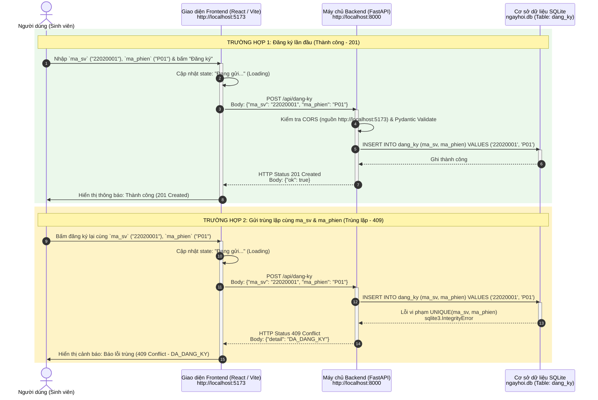
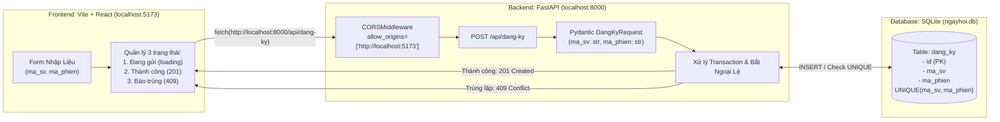

# Sơ đồ kiến trúc luồng dữ liệu Cổng đăng ký Ngày hội việc làm

## 1. Sơ đồ tuần tự tương tác (Sequence Diagram)

---

## 2. Sơ đồ kiến trúc tổng thể (Architecture & Flow)

---

## 3. Chi tiết thiết kế các thành phần

| Thành phần | Công nghệ | Vai trò & Đặc tả kỹ thuật |
| :--- | :--- | :--- |
| **Giao diện (Frontend)** | Vite + React | - Chạy tại `http://localhost:5173`. - Có form nhập `ma_sv` và `ma_phien`. - Hiển thị trực quan 3 trạng thái: Đang gửi (Loading), Thành công (201 Created), Trùng lặp (409 Conflict). |
| **Máy chủ (Backend)** | FastAPI + Uvicorn | - Chạy tại `http://localhost:8000`. - Endpoint tiếp nhận: `POST /api/dang-ky`. - `CORSMiddleware` cấu hình chuẩn xác chỉ mở cho `["http://localhost:5173"]`. - Trả về mã 201 (`{"ok": true}`) hoặc 409 (`{"detail": "DA_DANG_KY"}`). |
| **Cơ sở dữ liệu (Database)** | SQLite (`ngayhoi.db`) | - Bảng `dang_ky` với ràng buộc `UNIQUE(ma_sv, ma_phien)` nhằm đảm bảo sinh viên không thể đăng ký trùng 1 phiên. |

